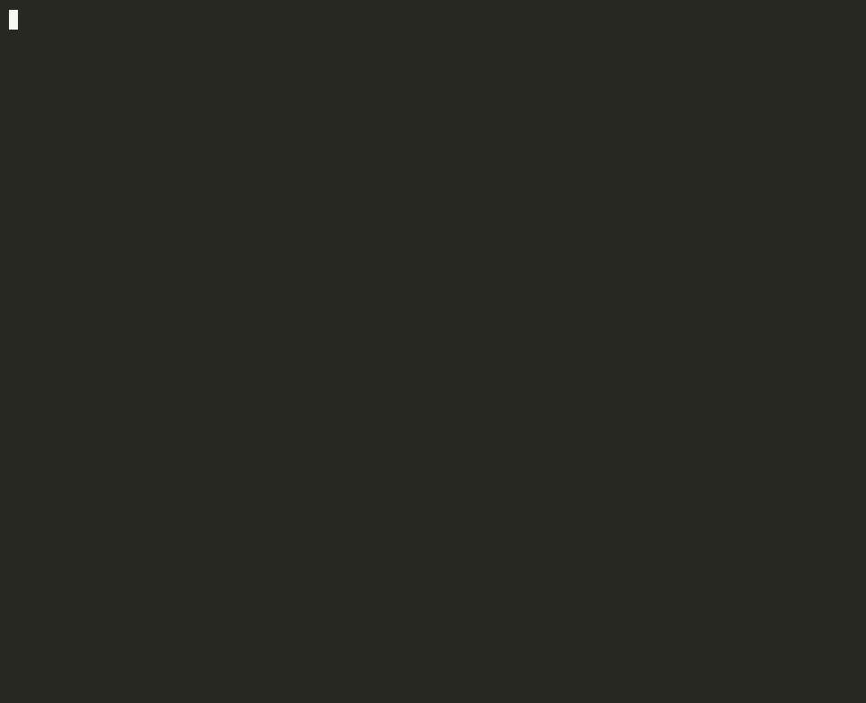

# shellmate

[](https://github.com/prameshbhattarai/shellmate/actions/workflows/ci.yml)

**Talk to your terminal, and learn how LangChain agents work by reading one.** Say what you want in
plain English; shellmate works out the shell commands, labels each one by risk, runs it after you
approve, reads the output, and keeps going until it can answer you. It runs on a local model (Qwen
via Ollama), so nothing leaves your machine.

The code is small on purpose and commented where each LangChain / LangGraph idea is used, so it
doubles as a worked example: [Learn LangChain by reading shellmate](#learn-langchain-by-reading-shellmate).



*A replayed session: the model's answers are scripted ([scripts/demo_replay.json](scripts/demo_replay.json)),
and everything else is real: the risk rules, the prompts, and the commands with their output.
Re-record with `./scripts/demo.sh`, or `./scripts/demo.sh --live` against your own model.*

## Quick start

```bash
# 1. A local model (one-off)
brew install ollama && ollama pull qwen2.5:3b     # or qwen2.5:7b: slower, noticeably smarter

# 2. Install
python3 -m venv .venv && source .venv/bin/activate
pip install -r requirements.txt
cp .env.example .env

# 3. Run
shellmate                                          # interactive
shellmate ask "what was my last commit message?"   # one request
shellmate --dry-run ask "remove all .pyc files"    # show the first command, run nothing
```

Every command is labelled by rules (never by the model) before it runs:

| Level | Examples | What happens |
|---|---|---|
| SAFE | `ls`, `du`, `git log`, `grep` | runs straight away |
| CAUTION | `mkdir`, `git add`, `>> file`, `pip install` | asks `y/N` |
| DANGER | `rm`, `mv`, `git push`, `> file`, `sudo`, unknown programs | needs the full word `yes` |
| BLOCKED | `rm -rf ~`, `curl … \| sh`, `dd` to a disk, `cd ~ && rm -rf *` | never runs |

At any approval prompt, `e` edits the command (it is checked again), Enter skips it, and **Ctrl-C
pauses** the run: `shellmate resume` continues it later, even after a restart.

## Learn LangChain by reading shellmate

Read the files in this order. Each step names the concept, where to look, and a small change to
try. Every file starts with a docstring naming its concept, and `# LangChain:` / `# LangGraph:`
comments mark the lines that matter.

### 1. The chat model: [`config.py`](shellmate/config.py)

`chat_model()` builds a `ChatOllama`. Every LangChain provider (ChatOllama, ChatAnthropic,
ChatOpenAI ...) has the same interface, so switching is a one-line change.

> **Try:** `python -c "from shellmate.config import chat_model; print(chat_model().invoke('hi').content)"`,
> then `.stream('hi')` to see tokens arrive in chunks.

### 2. Structured output: [`agent.py`](shellmate/agent.py), sections 1 and 2

`Decision` is a Pydantic model: the shape every model reply must have (`run` a command, `read_file`,
`list_dir`, or `answer`). `build_decider()` wraps the chat model with
`with_structured_output(Decision, method="json_schema")`, so `invoke()` returns a `Decision`
object instead of text you would have to parse.

> **Try:** add a field such as `confidence: int = 0` to `Decision` and print it in `graph.decide`.
> Give it a default: replies (and the test fakes) that leave it out must still be valid.

### 3. Prompts and message history: [`agent.py`](shellmate/agent.py), sections 3 and 4

`SYSTEM_PROMPT` holds the instructions, and only the rules for your OS are added (`os_rules()`).
`build_messages()` rebuilds the whole conversation each turn as `("system" | "human" | "ai", text)`
messages: the request, then what the model did and what came back, for every step.

> **Try:** print `build_messages(...)` inside `graph.decide` to see exactly what the model reads.

### 4. Tools: [`tools.py`](shellmate/tools.py)

`run_command`, `read_file` and `list_dir` are the only things the agent can do. The model only
*names* one; the graph calls it and sends the result back as the next message.

> **Try:** add a `count_lines` tool: a function in `tools.py`, its name in `agent.TOOL_ACTIONS`
> (that one tuple feeds both the `Decision` schema and the routing to `use_tool`), a branch in
> `graph._run_tool`, and a line in `SYSTEM_PROMPT` so the model knows it exists.

### 5. The agent loop as a LangGraph `StateGraph`: [`graph.py`](shellmate/graph.py)

The core of the project, laid out in five numbered sections:
- **State**: a `TypedDict` shared by every node, with an `operator.add` reducer that appends steps.
- **Nodes**: plain functions that return partial updates (`decide`, `use_tool`, `classify_risk`,
  `ask_human`, `run`, `refuse`).
- **Routing**: conditional edges that read the state and return the next node.
- **Wiring**: `add_node` / `add_edge`; the edges back to `decide` make it a loop, and a step cap
  stops it.
- The module docstring explains why this is hand-built instead of using `create_agent`.

> **Try:** lower `SHELLMATE_MAX_STEPS` to 1 in `.env` and watch the loop stop early.

### 6. Human in the loop: `graph.ask_human` and [`cli.py`](shellmate/cli.py)

`interrupt()` pauses the graph mid-run and hands the CLI a question. The CLI asks you, then resumes
with `Command(resume=reply)`. `cli._drive` also shows `graph.stream(..., stream_mode="updates")`,
which draws each node's result as it happens.

> **Try:** run with `--confirm-all` so even SAFE commands pause at `ask_human`.

### 7. Memory: [`memory.py`](shellmate/memory.py)

A checkpointer saves the state after every step, keyed by `thread_id`. `InMemorySaver` (tests)
forgets on exit; `SqliteSaver` (the CLI) writes to `~/.shellmate/checkpoints.sqlite`, and that one
swap is what lets `shellmate resume` continue a paused run in a new process.

> **Try:** press Ctrl-C at an approval prompt, quit, then run `shellmate resume`.

### 8. Testing an agent without a model: [`tests/fakes.py`](tests/fakes.py)

The graph only calls `decider.invoke(messages)`, so `ScriptedDecider` (a fixed list of `Decision`s)
can stand in for the model. [`tests/test_graph.py`](tests/test_graph.py) scripts whole
conversations and checks how the graph reacts. No test calls Ollama.

> **Try:** write a test where the model proposes `rm -rf ~` and assert it ends up `blocked`.

### 9. Evals: [`evals/run_evals.py`](evals/run_evals.py)

55 requests, each with the expected action, a regex for the command and the expected risk level.
`--check` validates the set with no model (CI runs it); `--model` scores real models.

**Optional:** [`risk.py`](shellmate/risk.py) is plain Python, not LangChain: the rule engine behind
the safety levels. [docs/how-it-works.md](docs/how-it-works.md) has flowcharts of the whole flow.

## Evals

```bash
python evals/run_evals.py --check                              # no model: is the eval set consistent?
python evals/run_evals.py --model qwen2.5:3b,qwen2.5:7b        # score models (one call per case)
```

Scoring asks each model for the first step of every case and never runs anything.

| Model | Pass | Right action | Command matches | Risk label |
|---|---|---|---|---|
| qwen2.5:3b | not run yet | | | |
| qwen2.5:7b | not run yet | | | |

## Configuration

Settings come from `.env` (see [.env.example](.env.example)): the model and Ollama URL, the context
size, the step cap, the command timeout, the output cap, and `SHELLMATE_HOME` (default
`~/.shellmate`, where paused runs are saved).

## Project layout

```
shellmate/
  config.py      # 1. the chat model, and settings
  agent.py       # 2-3. Decision schema, structured output, prompt, message history, guards
  tools.py       # 4. run_command, read_file, list_dir
  graph.py       # 5-6. the LangGraph loop and the interrupt() approval
  cli.py         # 6. streams the graph, answers interrupts; `ask`, `resume`, the REPL
  memory.py      # 7. SQLite checkpointer and the paused run
  risk.py        # rule-based risk levels (plain Python)
  replay.py      # scripted answers for the demo recording
docs/            # how-it-works.md (flowcharts), demo.gif
evals/           # 9. 55 cases and the scorer
scripts/         # demo.sh records the GIF
tests/           # 8. 229 tests with a scripted fake model; never call Ollama
```

## License

MIT
