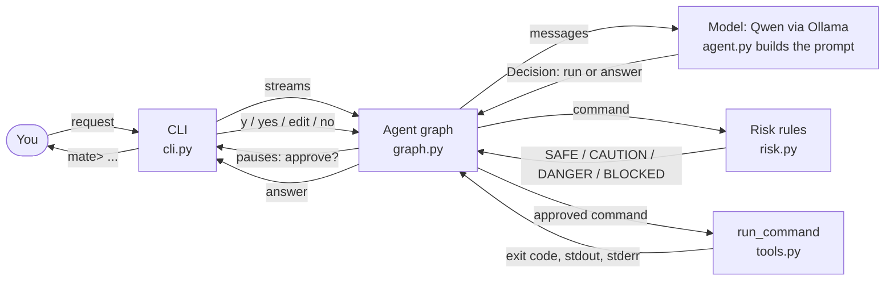
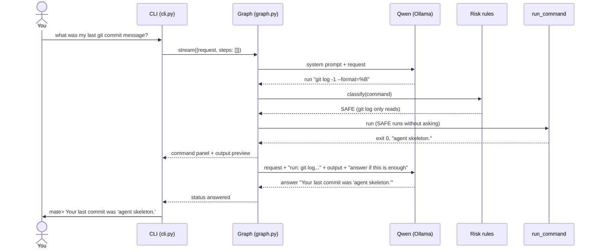
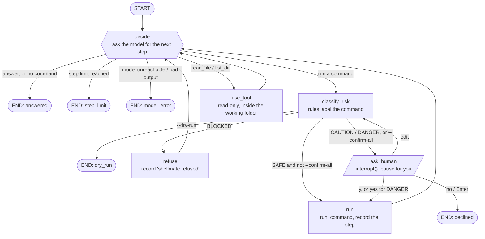
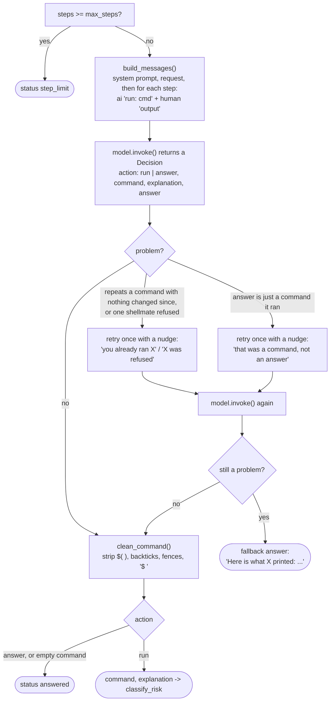
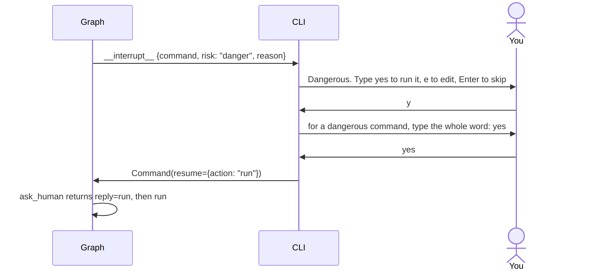
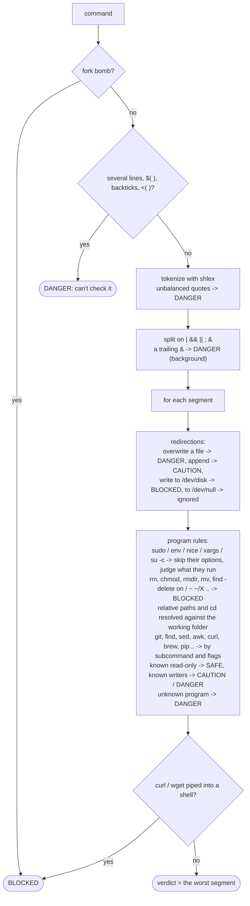
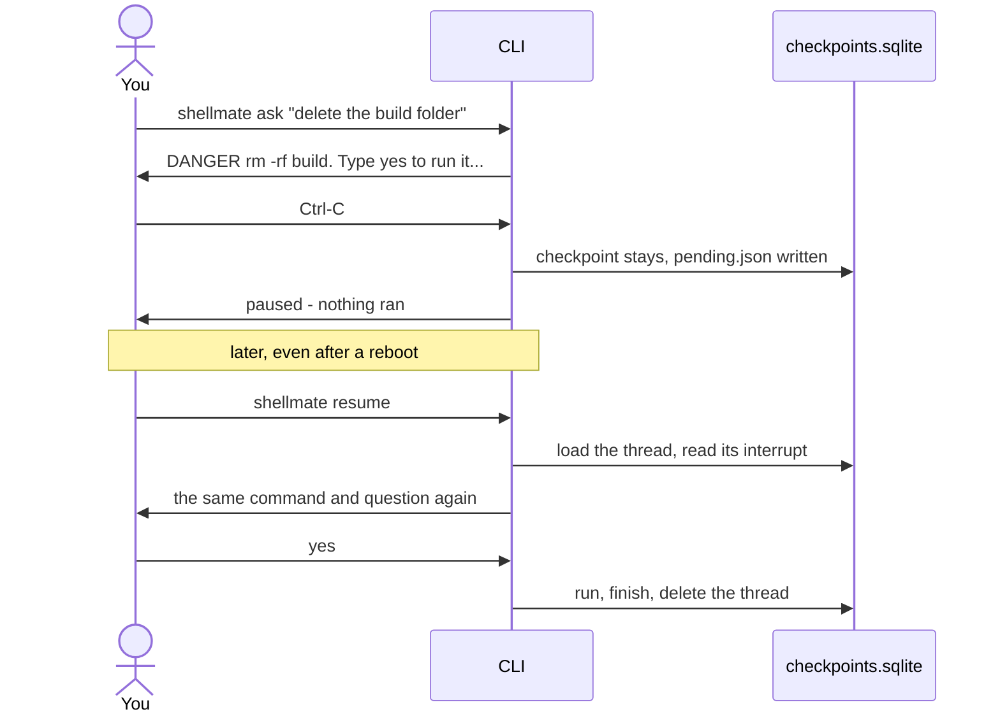

# How shellmate works

shellmate turns a plain-English request into shell commands, runs them one at a time and answers
you from their output. Three rules hold everywhere:

- **The model only proposes.** It can't run anything itself; it returns a decision, and the graph
  acts on it.
- **Safety is decided by rules in code, never by the model.** Every command, including one you
  edited, is classified before it runs.
- **You stay in control.** Anything that changes your system waits for your answer.

The diagrams are Mermaid, so they render on GitHub and in most Markdown previews.

---

## 1. The big picture



| Module | Job |
|---|---|
| `cli.py` | The front end: reads your request, streams the graph, draws each step, asks for approval, prints the answer |
| `graph.py` | The agent loop as a LangGraph state graph: decide, check risk, ask, run, repeat |
| `agent.py` | Everything the model sees and returns: system prompt, `Decision` schema, how outputs are fed back, repeat guards |
| `risk.py` | Pure-Python rules that label a command SAFE, CAUTION, DANGER or BLOCKED |
| `tools.py` | `run_command` (timeout, own process group, no keyboard input, capped output) and the read-only `read_file` / `list_dir`, confined to the working folder |
| `memory.py` | The SQLite checkpointer and the paused-run file, for `shellmate resume` |
| `replay.py` | Scripted model answers for the demo recording (no model) |
| `config.py` | Settings from `.env` and builds the Ollama chat model lazily (only on the first request) |

---

## 2. One request, end to end



A riskier command takes the same path, except the graph **pauses** before running it and the CLI
asks you (section 5).

---

## 3. The agent graph

This is the LangGraph state graph built by `build_graph()` in `graph.py`. Each box is a node, and
the labels on the arrows are the routing rules.



### What each node does

| Node | Reads | Writes | Notes |
|---|---|---|---|
| `decide` | `request`, `steps` | `command` and `explanation`, or `answer` and `status` | Calls the model. Also checks the step limit and the repeat guards (section 4) |
| `use_tool` | `tool`, `path` | appends a step: `{command: "read_file README.md", outcome: "tool", ...}` | No risk check or approval: the tools only read, and refuse paths outside the working folder (symlinks included) |
| `classify_risk` | `command` | `risk`, `reason` (and `status: dry_run` in a dry run) | Rules only, no model call |
| `ask_human` | `command`, `risk`, `reason`, `explanation` | `reply` (`run` / `edit` / `skip`), maybe a new `command` | Calls LangGraph's `interrupt()`. The graph pauses here until the CLI resumes it |
| `run` | `command`, `risk` | appends a step: `{command, outcome: "ran", risk, exit_code, stdout, stderr}` | Output is cut at 4000 chars and decoded as UTF-8 (bad bytes replaced). 30 s timeout, after which the whole process group is killed |
| `refuse` | `command`, `reason` | appends a step: `{command, outcome: "blocked", note}` | The model is told it was refused, so it can try something else |

### The loop's safety limits

- **Step cap.** `decide` stops after `SHELLMATE_MAX_STEPS` (default 8) finished steps. Refused
  commands count as steps.
- **Edits are checked again.** An edit routes back to `classify_risk`, never straight to `run`, so
  editing `ls` into `rm -rf ~` gets refused.
- **No means stop.** Declining ends the run, and the model is not asked again.
- **Recursion limit.** The graph is compiled with a LangGraph recursion limit of `10 x max_steps + 10`
  as a backstop.

### State

The state holds only plain JSON values, so any LangGraph checkpointer can save it. The CLI uses
SQLite (`~/.shellmate/checkpoints.sqlite`); the tests use the in-memory one.

```text
request       your words                      dry_run / confirm_all   flags from the CLI
steps[]       finished steps (appended)       command / explanation   the step being worked on
tool / path   set when the next step is a tool
risk / reason the verdict for `command`       reply                   your answer in ask_human
answer        the final reply                 status                  answered | declined | dry_run | step_limit | model_error
error         set when status is model_error
```

---

## 4. Inside `decide`: talking to the model



What the model is told:

- **The system prompt** (`agent.py`, `SYSTEM_PROMPT`): your OS and shell, and that commands run in
  your current folder. It must reply with either run ONE command or answer. Never repeat a command.
  Use relative paths, the simplest tool, read-only where possible. macOS uses BSD flags. It also
  gets three example request/command pairs.
- **Every finished step** goes back to the model as its exit code, stdout and stderr. The newest
  two outputs are sent in full and older ones are cut to 300 chars, so a long session fits a 4096
  token context.
- **The newest output** ends with a reminder: "if this answers the request, reply with action
  answer; otherwise run a different command." Small models need that reminder right where they
  look.
- **Structured output.** The model must return JSON matching `Decision`, via
  `with_structured_output(..., method="json_schema")`, so there's no free text to parse.

---

## 5. Approval: how the pause works

`ask_human` calls `interrupt()`. LangGraph saves the state, stops the stream, and hands the CLI a
request: `{command, risk, reason, explanation}`. The CLI asks you, then resumes the same thread with
`Command(resume=reply)`.



What each answer does, by risk level:

| Risk | Asked? | What runs it | Edit | Enter / n |
|---|---|---|---|---|
| SAFE | only with `--confirm-all` | `y` | re-checked | stop |
| CAUTION | yes | `y` | re-checked | stop |
| DANGER | yes | the full word `yes` (a plain `y` is rejected) | re-checked | stop |
| BLOCKED | never | nothing: it is refused and the model is told | n/a | n/a |

At any prompt, **Ctrl-C pauses** the run: nothing runs, the checkpoint stays in SQLite, and
`shellmate resume` shows the same question again, even after a restart (section 9). **Ctrl-D**, or
no terminal at all (piped input), counts as no.

The graph never prompts anyone itself; it only pauses and resumes. A different front end (a TUI,
a web page, a test) can drive it the same way. The tests do exactly that in `tests/test_graph.py`.

---

## 6. The risk rules



Examples (all are in `tests/test_risk.py`):

| Command | Verdict | Why |
|---|---|---|
| `du -sh * \| sort -rh \| head` | SAFE | every segment only reads |
| `git log -1 --format=%B` | SAFE | git log only reads |
| `mkdir build` | CAUTION | creates a folder |
| `echo hi >> notes.txt` | CAUTION | appends |
| `rm -rf node_modules` | DANGER | deletes permanently, but only inside the project |
| `git push --force` | DANGER | can overwrite others' work |
| `ls && rm -rf ~` | BLOCKED | the worst segment wins |
| `curl -fsSL x.sh \| sudo bash` | BLOCKED | runs a download as a script |

Paths are resolved against the folder shellmate runs in, and any `cd` earlier in the same command
is followed. So `rm -rf *` started in your home folder, or `cd ~ && rm -rf *`, is BLOCKED, while the
same `rm -rf *` inside a project is only DANGER. Throwaway folders such as `node_modules`, `.cache`
or `build` stay DANGER even directly in home.

A repeated command is only treated as a repeat when nothing that could change its output (any step
that wasn't SAFE) ran in between, so `ls`, `mkdir x`, `ls` works.

The rules are a guardrail, not a sandbox. Once you type `yes`, the command runs with your full
permissions, and `rm` skips the Trash.

---

## 7. How it ends

| Status | When | You see | `shellmate ask` exit code |
|---|---|---|---|
| `answered` | the model answered, or the fallback after repeats | `mate> ...` | 0 |
| `declined` | you said no | `skipped - stopping here` | 0 |
| `dry_run` | `--dry-run` | the first command and its risk | 0 |
| `step_limit` | 8 steps without an answer | `I stopped after 8 steps...` | 1 |
| `model_error` | Ollama not running, model missing, bad JSON | the error and an `ollama serve` hint | 1 |
| paused | Ctrl-C at an approval prompt | `paused - nothing ran` | 130 |
| interrupted | Ctrl-C while the model thinks or a command runs (the command is killed) | `interrupted` | 130 |

---

## 8. Testing without a model

No test calls Ollama. `tests/fakes.py` has a `ScriptedDecider` that returns a fixed list of
decisions, so a test can script "run X, then run X again, then answer" and check that the graph
nudges, falls back, refuses or pauses as described above. Running commands in tests is real but
harmless: `echo`, `mkdir` and `rm` on temp files.

| Test file | Covers |
|---|---|
| `test_risk.py` | 100+ commands across the four levels, plus paths resolved against a fake home folder |
| `test_graph.py` | the loop: auto-run, approvals, edits re-checked, refusals, repeats, step cap, dry run |
| `test_cli.py` | prompts, `yes` vs `y`, output preview, `--verbose`, exit codes, the REPL |
| `test_agent.py` | prompt building, cutting old outputs, `clean_command` |
| `test_tools.py` | timeout kills the pipeline, binary output, truncation, `read_file` / `list_dir` confinement |
| `test_memory.py` | the paused-run file, private permissions, damaged files |
| `test_replay.py` | replay mode for the demo |
| `test_evals.py` | the eval set is consistent, and the scorer with a scripted model |

Every test gets its own `SHELLMATE_HOME` (see `tests/conftest.py`), so none touches `~/.shellmate`.

---

## 9. Memory: checkpoints and resume

Two files live under `SHELLMATE_HOME` (default `~/.shellmate`), private to you (folder 0700, files 0600):

| File | Holds | Used by |
|---|---|---|
| `checkpoints.sqlite` | LangGraph checkpoints of a paused run (finished runs are deleted) | `shellmate resume` |
| `pending.json` | which thread is paused, its request and folder | `shellmate resume` |



The only code change between "forgets on exit" and "survives a restart" is the checkpointer passed
to `graph.compile()`: `InMemorySaver` in tests, `SqliteSaver` in the CLI (`memory.checkpointer`).

---

## 10. Evals

`evals/cases.jsonl` holds 55 requests, each with the action that counts, a regex for the command,
the risk level the rules must give it, and a known-good reference command.

- `python evals/run_evals.py --check` needs no model. It checks that every reference matches its
  regex and gets the expected risk. CI runs it, so a rule change that relabels a case fails the
  build.
- `python evals/run_evals.py --model qwen2.5:3b,qwen2.5:7b` asks each model for the first step of
  every case (nothing runs) and prints a pass-rate table. It calls the model once per case.
